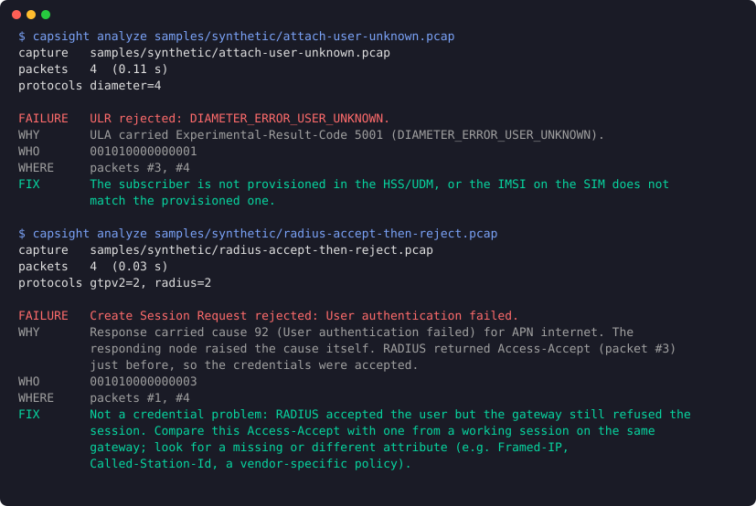

# capsight

**Drop in a mobile-core packet capture (4G, 5G, SS7), get a plain-English diagnosis of why a device couldn't attach, register, roam or get data.**

> Status: early development, v0.2. 4G core (Diameter S6a, GTPv2-C, EPS NAS, RADIUS) and 5G SA (NGAP, 5G NAS, PFCP, GTP-U) work today. See [docs/PLAN.md](https://github.com/Kx96xx/capsight/blob/main/docs/PLAN.md).

**Try it in the browser:** [capsight-dewfuba7pvrbayxcmnamqb.streamlit.app](https://capsight-dewfuba7pvrbayxcmnamqb.streamlit.app/) (pick a demo capture or upload your own; the app sleeps when idle and takes ~30 s to wake).



Debugging a mobile core usually means scrolling through thousands of Diameter, GTP and NAS packets in Wireshark and looking up result codes and cause values by hand. capsight does that part: it pairs requests with answers, matches known failure patterns and tells you what broke, for whom, where in the capture, and what to check next.


## Who it is for

- **Core / NOC engineers**: a customer says "my device won't connect". Grab a capture, run capsight, get the reject and the subscriber in seconds instead of reading packets.
- **Private LTE/5G and lab builders** (Open5GS, free5GC, srsRAN): find out why your phone won't attach to the network you just set up.
- **Students and people learning telecom**: see what a failure means in plain words, with the packet numbers to open in Wireshark.
- **Automation**: run it in a script or CI job on captures from a test lab and fail the build if a reject appears.

## Install

You need Python 3.11+ and `tshark` (comes with Wireshark).

```bash
# tshark
brew install wireshark          # macOS
sudo apt install tshark         # Debian/Ubuntu

# capsight
pip install capsight             # from PyPI (after the first release)

# or from source
git clone https://github.com/Kx96xx/capsight.git
cd capsight
uv sync
```

## Quick start

Generate a few demo captures (synthetic, safe to share) and analyze them:

```bash
uv run python scripts/make_demo_captures.py
uv run capsight analyze samples/synthetic/attach-user-unknown.pcap
uv run capsight analyze samples/synthetic/radius-accept-then-reject.pcap
uv run capsight analyze samples/synthetic/ipv4v6-rejected.pcap
```

## How to use it

### 1. Get a capture

capsight reads `.pcap` / `.pcapng` files. Capture on the interface that carries the signalling you care about:

| Problem | Capture where | Filter example |
|---|---|---|
| 4G: device won't attach | MME (S1-MME + S6a) | `sctp or port 3868` |
| 4G: attached but no data | MME/SGW/PGW GTP-C | `udp port 2123` |
| 4G: session rejected by AAA | PGW + RADIUS | `udp port 2123 or udp port 1812 or udp port 1813` |
| 5G: gNB or phone won't register | AMF (N2) | `sctp port 38412` |
| 5G: registered but no PDU session | AMF + SMF/UPF (N2, N4) | `sctp port 38412 or udp port 8805` |
| 5G: session up but no internet | UPF (N3 + N6) | `udp port 2152 or icmp` |

```bash
tshark -i any -f "sctp or port 3868 or udp port 2123" -w attach.pcapng
```

Reproduce the problem (power-cycle the device, toggle airplane mode), then stop the capture.

### 2. Analyze

```bash
capsight analyze attach.pcapng
```

Each finding has:

- **Severity**: `FAILURE` (it broke), `WARNING` (degraded or partially working), `INFO` (looks odd but is normal, e.g. a first-attach SQN resync)
- **WHY**: the exact code or cause and what it means
- **WHO**: the subscriber(s) affected (IMSI)
- **WHERE**: packet numbers. Open the capture in Wireshark and jump there with `Ctrl+G`
- **FIX**: what to check next

Repeated failures are grouped into one finding with a count. Retransmissions of the same request are counted once, so a retransmission storm does not look like a thousand failures.

### 3. Options

```bash
capsight analyze FILE [--format text|json] [--timeout SECONDS] [--fail-on failure|warning|never]
```

| Option | What it does |
|---|---|
| `--format json` | machine-readable output, for scripts and dashboards |
| `--timeout 5` | seconds without an answer before a request counts as unanswered (default 5) |
| `--fail-on failure` | exit code 1 if any failure is found (use in CI or scripts) |

Exit codes: `0` ok, `1` findings at the `--fail-on` level, `2` the capture could not be read.

### Follow one subscriber

When a capture has many devices, `--imsi` shows one subscriber's steps in order and where
they stopped, plus only the findings about that subscriber:

```
$ capsight analyze attach.pcap --imsi 001010000000001

subscriber 001010000000001
  +   0.000s  #7          nas       Attach Request                               ok
  +   0.001s  #8,#9       diameter  AIR -> AIA                                   FAILED  DIAMETER_ERROR_USER_UNKNOWN (5001)
  +   0.004s  #10         nas       Attach Reject                                FAILED  EMM cause #8 (...)
  stopped at: AIR -> AIA (packet #9), DIAMETER_ERROR_USER_UNKNOWN (5001)
```

If the IMSI is not in the capture, capsight lists the subscribers it did find. The IMSI can
be written as `001010000000001` or `imsi-001010000000001`. In 5G the subscriber is known only
when the SUCI is not concealed.

### Most likely cause

When a capture has more than one problem, the report opens with the one to read first.
Findings that join messages (a Create Session refused because the UPF refused it, two APNs
sharing one address) rank above a single refusal code, which ranks above timeouts and
aborts; the more frequent wins a tie. `--format json` has it as `most_likely_cause`.

### Busy captures: --summary

On a capture with thousands of failures, `--summary` gives the shape of the problem in one
screen: top problems by occurrences (with first/last time and how many subscribers),
the most affected subscribers, and problems over time:

```
$ capsight analyze hss-5min.pcapng --summary

summary   11 problems, 32,185 occurrences, 7,553 subscribers affected

MOST LIKELY CAUSE
  AIR rejected: DIAMETER_ERROR_USER_UNKNOWN.

TOP PROBLEMS
   1. FAILURE    28,384x  AIR rejected: DIAMETER_ERROR_USER_UNKNOWN.
                          16:25:00 - 16:34:59 UTC, 6,496 subscribers
   2. FAILURE     3,327x  AIR rejected: DIAMETER_ERROR_UNKNOWN_EPS_SUBSCRIPTION.
   ...
MOST AFFECTED SUBSCRIBERS
  001010000000001          57x  AIR rejected: DIAMETER_ERROR_USER_UNKNOWN.
  ...
OVER TIME (UTC, per 1 min)
  16:25  ######################################## 5,976
  16:30  #### 559
```

Time buckets grow with the capture (1 minute up to a day) so the chart stays under 25 rows.
`--format json --summary` adds the same data under `summary`. Without `--summary`, capsight
suggests it once a capture has 100+ problem occurrences.

### Sharing output: --redact

`--redact` masks what should not leave your network before you paste output into a ticket
or chat. It works with every other option (`--summary`, `--imsi`, `--format json`):

- subscriber numbers (IMSI, MSISDN) become `00101-sub1`, `00101-sub2`, ... The first 5
  digits (the home network) are kept because they are often the diagnosis; `--redact-all`
  hides them too
- IP addresses become `ip1`, `ip2`, ...; host names and Diameter realms become `host1.invalid`
- the capture's file name becomes `capture.pcap`

The same value always gets the same placeholder within a run, so "these 40 failures are the
same subscriber" still shows. The last line says how many values were masked.

### 4. Web demo

A small upload page, for people who would rather not use a terminal:

```bash
pip install "capsight[web]"
capsight-web                     # http://127.0.0.1:7860
```

Uploads are analyzed in a temporary folder and deleted right after. The [hosted demo](https://capsight-dewfuba7pvrbayxcmnamqb.streamlit.app/) runs
`web/streamlit_app.py` on Streamlit Community Cloud; `web/Dockerfile` builds the Gradio page
as a container for self-hosting.

### 5. Use it in scripts / CI

```bash
for f in captures/*.pcapng; do
  capsight analyze "$f" --fail-on failure > "${f%.pcapng}.txt" || echo "FAILED: $f"
done

capsight analyze attach.pcapng --format json | jq '.findings[] | {severity, verdict, count}'
```

## What it detects today

**Diameter (S6a and base protocol)**
- Failure Result-Code / Experimental-Result-Code: user unknown, roaming not allowed, RAT not allowed, unknown EPS subscription, auth data unavailable, unable to deliver, too busy, ...
- Requests that never got an answer

**GTPv2-C**
- Rejections with the cause and the APN: missing or unknown APN, APN access denied, IP pool exhausted, context not found, system failure, ...
- Whether the cause came from the responder or a node further down the path
- **User authentication failed right after RADIUS Access-Accept**: credentials were fine, the gateway refused on policy
- **PDN type split**: IPv4v6 rejected while IPv4 works for the same subscriber
- Requests with no response, and retransmission folding

**Policy and charging (Gx, Gy)**
- Policy server (PCRF) and online charging (OCS) rejects, named by interface and request type (e.g. `Gy CCR-I rejected: DIAMETER_CREDIT_LIMIT_REACHED`), with what it means for the user: refused at setup, stopped mid-session, or only a charging-record problem at the end
- Links a rejected initial request to the session reject it caused, so one problem is not reported as two
- A single service (rating group) out of credit while the rest of the session works, with what happens next (terminate, redirect to a top-up page, restrict)
- Policy rules the gateway could not install (Charging-Rule-Report), with the rule name and reason
- Says which server to fix: "user unknown" in the PCRF/OCS is a different job than in the HSS

**Roaming**
- Session requests from a visited network rejected or unanswered by the home network (S8), with the visited network as MCC/MNC and a roaming-specific reading of the cause
- Roaming is only claimed when the capture proves it: the request came from an SGW and its Serving Network is not the subscriber's home network. Never guessed from host names, realms or IPs
- S6a rejects (e.g. roaming not allowed) show the visited network from the Visited-PLMN-Id field

**MAP (2G/3G over SS7 / SIGTRAN)**
- Authentication, location update and SMS errors, named by operation with what to check: e.g. `SendAuthenticationInfo rejected: unknown subscriber (diagnostic: IMSI unknown)`, `UpdateLocation rejected: roaming not allowed (cause: PLMN roaming not allowed)`, `MO-ForwardSM rejected: SMS delivery failure (cause: unknown service centre)`
- Error details the HLR/MSC sends: unknown-subscriber diagnostic, roaming-not-allowed cause, absent-subscriber diagnostic, SMS delivery failure cause, the node behind a system failure
- Subscriber state (absent for SMS, busy) reported as a warning, not a network failure
- TCAP dialogue aborts with the reason: provider abort (e.g. unrecognized transaction ID, a sign of asymmetric routing), MAP user abort, dialogue refused because the peer does not support the MAP version
- TCAP rejects (mistyped parameter, unrecognized operation, ...) and operations never answered within the MAP timer
- Captures that hold only part of the traffic (answers whose requests are not in the capture) get one warning, so timeouts are not over-read
- Handles SCTP bundling (several TCAP messages per packet) and the same message seen on both legs of an STP

**NAS (EPS)**
- Attach / TAU / Service Reject with EMM cause, linked to the subscriber even when the reject carries no IMSI
- Authentication failure: MAC failure (SIM and HSS keys differ) vs sync failure (and whether it recovered)
- PDN Connectivity Reject, and whether it happened during attach (failure) or for an extra APN after a working attach (warning)

**5G SA**
- NGAP failures with the cause, e.g. NG Setup rejected for an unknown PLMN or tracking area
- Registration / Service / Security Mode Reject with 5GMM cause (no slices available, PLMN not allowed, ...)
- 5G-AKA authentication failure: MAC failure (keys mismatch) vs sync failure, and whether the network then rejected
- PDU session request refused by the AMF (e.g. 5GMM #91, DNN not subscribed), naming the DNN
- PDU Session Establishment Reject from the SMF with 5GSM cause and DNN
- PFCP rejects between SMF and UPF (rule creation failure, no association, no resources, ...) and unanswered PFCP requests
- Session refusals traced from the gateway's GTP-C cause to the UPF's PFCP refusal behind it, including two sessions fighting over one UE address
- One-way user plane: uplink enters the GTP-U tunnel and nothing comes back, with a NAT hint when a private UE address leaks onto N6
- SUPI shown when the SUCI is not concealed; never guessed when it is
- **Ciphered NAS** (NEA1/2/3): says how many NAS messages could not be read and with which algorithm, then infers the outcome from NGAP, which is not encrypted: registration that never completed (no Initial Context Setup, UE released), or registered but no PDU session set up. Each inference names its NGAP evidence and where to look next (AMF/SMF logs)

Checked against real public captures, 4G and 5G: [docs/VALIDATION.md](https://github.com/Kx96xx/capsight/blob/main/docs/VALIDATION.md).

## How it works

1. **Decode**: `tshark` turns the capture into structured fields. capsight never writes its own dissectors.
2. **Correlate**: requests are paired with answers (Diameter hop-by-hop + end-to-end ID, GTPv2 and PFCP sequence numbers, MAP invoke ID within the TCAP dialogue), and NAS messages are linked to a subscriber through the S1AP / NGAP UE ID.
3. **Diagnose**: deterministic rules match known failure patterns. Every verdict cites packet numbers. Nothing is guessed.

## Privacy

Captures contain subscriber identities. capsight runs entirely on your machine, sends nothing anywhere, and stores nothing. Do not commit real captures: the repo's `.gitignore` blocks `*.pcap` / `*.pcapng` outside `samples/`. Use `--redact` before sharing output.

## Roadmap

v0.2 real-capture usability (released), v0.3 operator coverage: roaming, Gx/Gy, MAP, ciphered 5G NAS (released), v0.4 voice and SMS, v0.5 diagrams/HTML/MCP, v1.0 stable. Details and exit tests: [docs/ROADMAP.md](https://github.com/Kx96xx/capsight/blob/main/docs/ROADMAP.md).

## Contributing

Public captures that show a failure are the most useful contribution. Open an issue with a link (never attach captures with real subscriber data).

```bash
uv run pytest        # tests generate their own captures; tshark required
uv run ruff check .
```

## License

MIT
